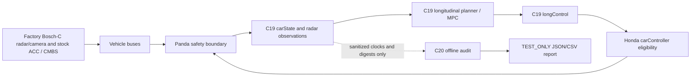

# R10–R12 combined offline engineering report — 2026-11-28

Scope: `tools/c20_accord11g_long_shadow/**` on branch `c20-r10-r12-combined-r13-prep-20261128`, parent `3a5b630efc9346fb61e13c9d52ab446729fffde5`. The unchanged C19 source is `a32dcc0a6e62a4e2a15d9ac4425424e598313c98`. This is **TEST_ONLY / RESEARCH**. Active Alpha Long and public-road release are **NO_GO**. See [R9 evidence](R9_CAMPAIGN_REPORT.md) and [owner risk acceptance](risk_acceptance.md).

## R10: actual C19 source and platform

Read-only source paths inspected at the C19 commit:

| Source | Observed contract |
| --- | --- |
| `openpilot/selfdrive/controls/lib/longitudinal_mpc_lib/long_mpc.py` | Imports generated `AcadosOcpSolverCython` and CasADi. `N=12`, `MAX_T=10`, SQP_RTI. `ModelLeadHistory` retains up to four recent frames, checks model/radar/car source and receiver clocks, and matches radar `mdMonoTime` to a model frame. `build_model_lead_trajectory` needs complete `x,y,v,t` arrays, the model time grid, matching radar lead and finite values. |
| `openpilot/selfdrive/controls/lib/longitudinal_planner.py` | `NATIVE_PLAN_INPUTS` are carControl, carState, controlsState, vehicleParameters, radarState, modelV2, selfdriveState. It also consumes CP, cruise state, personality, profile tuning, lead history, prior acceleration/filter state, many mode and preference owners, reset/drive boundaries, and source/receiver timestamps. `mpc.update` is only one part of its cycle. |
| `acados_ocp_long.json` and `c_generated_code` | JSON dimensions `N=12`, horizon `tf=10.0`, SQP_RTI, partial-condensing HPIPM. The compiled Cython `.so` and five bundled libraries are AArch64 ELF. `readelf` shows solver → `libacados_ocp_solver_long.so` → `libacados.so` → `libhpipm.so`, `libblasfeo.so`, `libqpOASES_e.so.3.1`; system `libc` and `libm` are also required. Solver RUNPATH contains an image-specific virtualenv path and `$ORIGIN`; runtime resolution on target hardware is unverified. |
| Honda interface/controller/values in `opendbc_repo` | Accord 11G is Bosch CAN-FD / Bosch-C. Interface sets `alphaLongitudinalAvailable` false for Bosch CAN-FD and retains `pcmCruise` when openpilot Long is off. Source comments warn that radar disable removes AEB. Controller contains a radar keepalive path only when openpilot longitudinal ownership is enabled; C20 does not call or alter it. |

The machine-checkable [platform receipt](../fixtures/r10_platform_receipt.json) lists SHA-256, bytes, ELF architecture and `DT_NEEDED` for each artifact, plus source hashes, C19 commit, Python and readelf versions. The solver SHA-256 is `111ca810cbf69707124162374f3b320349afc0c039ee83d18b0949cfc4072387`. The host is x86_64 with Python 3.12.3 and GNU readelf 2.42. gcc, clang, cmake and ninja are present; an AArch64 cross compiler was not found. `numpy` is importable; `casadi`, `scipy`, and `capnp` are absent in this Python environment. A cached CasADi tree was found read-only; no cached SciPy package was found. Nothing was installed or treated as a working dependency from cache. No AArch64 binary was loaded. Native execution eligibility is **BLOCKED** by architecture and required Python dependencies; same-cycle authentic planner inputs and receiver clocks are also absent. The generated source artifact is not a runnable host solver.

`platform_receipt.py` verifies the pinned inventory and checks a bounded external native-execution receipt against the exact C19 commit, solver SHA-256, AArch64 execution architecture, positive cycle count, and input digest. Pinned matching covers every source and generated artifact SHA-256 and byte count, ELF architecture, needed libraries, RUNPATH, and generated model options. Host architecture, Python dependencies/version, readelf version and native eligibility are reported separately; they are not compared with the reference host. A missing or changed library fails the source receipt even when the Git SHA matches. A supplied execution receipt digest can establish consistency only. With no trusted signing authority, the strongest result is `REFERENCE_MATCH_UNVERIFIED`; it never emits verified native execution.

## R11: sanitized future-capture contract

`telemetry_gate.py` accepts a manifest of fixed vehicle class and SHA-256 identities for fingerprint, ECU firmware set, C19 source, DBC, model, hardware, capture bytes and independent custody reference. It accepts a bounded versioned observation file of exact service source and receiver timestamps, per-service payload digests, radar `mdMonoTime`, up to four model history frame clocks and digests with two lead digests per frame, CP/planner/preference/drive-state digests, drive-token digest, reset marker, driver override, lead presence, clock agreement and source-integrity flags. The selected leads must match the radar associated frame in that bounded history; a prior frame can be selected when its timestamp differs from the current modelV2 frame. History continuity, 150 ms age, receipt ordering, no future use, and selected lead digest matching are checked. This mirrors the C19 `ModelLeadHistory` selection contract at the clocks and digests level; it does not reconstruct model payloads. It rejects unknown keys, duplicates, malformed values, symlinks and oversized files. The input carries no VIN, GPS, route name, raw CAN or driver data. A digest of a self-reported custody reference is **not** independent custody authentication; only `UNVERIFIED_SELF_REPORT` is accepted. No PKI or signature verifier is present, so claimed signed status is rejected.

The validator distinguishes **field presence**, **type/length and clock validation**, and **semantic source equivalence**. Even when synthetic fields pass, semantic C19 equivalence remains `UNVERIFIED_SERIALIZED_MESSAGES_ABSENT`: hashes and scalar clocks cannot reconstruct complete serialized model trajectories or planner memory. It never invents missing trajectories, acceleration proposals or brake calibration. The [capture](../fixtures/r10_r12_synthetic_capture.json) and [manifest](../fixtures/r10_r12_synthetic_manifest.json) are labeled `SYNTHETIC` in both files.

Temporal checks use each service's exact source and receipt nanoseconds: `source ≤ receipt ≤ cycle`, no future use, monotonic service clocks per drive, source age ≤200 ms and measured source gap ≤500 ms. Model history has the tighter C19 150 ms bound. It reports deterministic min/p50/p90/p99/max distributions. A route-token switch, any midstream reset, loss of lead, missing receiver clock, stale sample, unknown/future model lead, driver override, source-integrity fault, clock disagreement or provenance substitution locks the audit state at `FAULT_LOCKED`. JSON and CSV outputs contain labels, aggregate timing and faults only.

The four R9 historical segments are one older Candidate-1 route. Their validated hashes and schema counts (4,800 each of modelV2, radarState and longitudinalPlan; 23,889 sendcan) do **not** bind the exact current vehicle, its ECU firmware, DBC/model/hardware, independent custody, receiver times, complete lead history or C19 planner state. They cannot qualify a current-car C19 planner replay. See [R9 campaign report](R9_CAMPAIGN_REPORT.md) and [native gap inventory](../native_gap.py).

## R12: read-only architecture and audit state



The diagram traces existing C19 modules; it is **not** a proposal to connect C20 to a controller. Stock C19 keeps OEM longitudinal ownership for Accord 11G. The exact radar/camera ownership, factory CMBS/FCW/AEB behavior, CAN2 relay startup and recovery, Panda policy, driver gas/brake override and lead-loss response still require independent hardware evidence. `telemetry_gate.py` is a finite audit-state machine: `START → OBSERVING` for clean synthetic observations, and any fault → absorbing `FAULT_LOCKED`. These states cannot command a car. The source gate recursively parses every research Python file and forbids runtime control imports, dynamic imports and send-style methods; this is a scope check, not a Panda safety proof.

| Fault or dependency | Independent acceptance test before active control | C20 result |
| --- | --- | --- |
| A1 radar/camera ownership; CMBS/FCW/AEB interaction | Exact ECU firmware/wiring record, stock baseline, safe ownership and independent collision-mitigation evidence | **NO_GO**, hardware evidence absent |
| A2 CAN2/relay startup and recovery | HIL ignition, relay, brownout, watchdog and recovery traces with complete timestamp/custody chain | **NO_GO**, hardware evidence absent |
| A3 Panda/brake path | Independent exact firmware safety review and HIL limits, counters, timeout and malformed-frame fault tests | **NO_GO**, no actuation tested |
| A4 override/sensor/lead faults | HIL gas/brake/cancel, stale/future/missing model, radar loss, clock skew and recovery tests with no competing owner | **NO_GO**, offline audit faults only |
| A5 release/legal | Reproducible ARM64 product build, hardware qualification, rollback drill, independent safety case, insurance/regulatory decision | **NO_GO** |

Owner acceptance of potential OEM CMBS/FCW/AEB loss supports studying feasibility only. It does not establish safe braking, Panda authorization, equivalent collision mitigation or road readiness. R10 source inventory and R11/R12 synthetic audit implementation are complete; native C19 replay, authenticated current-car capture, HIL and all A1–A5 checks remain blocked or unperformed.

## Reproduce and review

From the C20 repository root, with no vehicle connection:

```sh
C20_C19_REPO=/path/to/pinned/C19
PYTHONDONTWRITEBYTECODE=1 python3 -m tools.c20_accord11g_long_shadow.platform_receipt --repo "$C20_C19_REPO" --pinned-inventory tools/c20_accord11g_long_shadow/fixtures/r10_platform_receipt.json
PYTHONDONTWRITEBYTECODE=1 python3 -m tools.c20_accord11g_long_shadow.telemetry_gate --manifest tools/c20_accord11g_long_shadow/fixtures/r10_r12_synthetic_manifest.json --capture tools/c20_accord11g_long_shadow/fixtures/r10_r12_synthetic_capture.json
PYTHONDONTWRITEBYTECODE=1 C20_C19_REPO="$C20_C19_REPO" python3 -m unittest discover -s tools/c20_accord11g_long_shadow/tests -q
PYTHONDONTWRITEBYTECODE=1 python3 -m tools.c20_accord11g_long_shadow.release_gate --repo .
git diff --check
```

The portable suite has 76 tests, including seven review regressions. Two C19 external integration tests skip only when the checkout is unavailable; the 74 remaining tests require no C19 path. On a connected host with the pinned checkout, all 76 run with zero skips. The source audit and original C19 prebuilt receipt remain separate checks. Native execution remains blocked. The exact R13 decision and host handoff are in [R13 release prep](R13_RELEASE_PREP.md).
